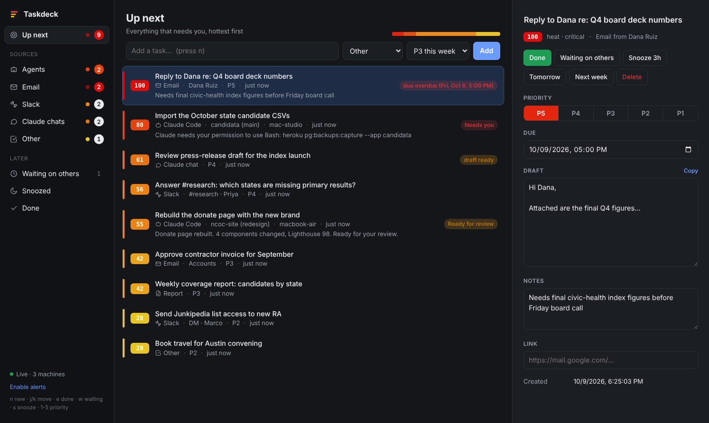

# Taskdeck

One board for everything that needs you: Claude Code agents running on any of
your Macs, Claude chats drafting emails and reports, and the email and Slack
requests piling up. Items are ranked by **heat** (0-100) so the top of the list
is always what to tackle next.



- **Left tabs** with badge counts and a heat dot (the colour of the hottest item in
  that tab; it pulses when something is critical): Up next, Agents, Email, Slack,
  Claude chats, Other, Waiting on others, Snoozed, Done.
- **Heat ranking.** Blocked agents rank highest, then overdue or urgent tasks,
  then finished agent turns awaiting review, then everything else. Email and Slack
  asks warm up the longer they sit. Parking a task as "waiting" cools it off.
- **Live** across machines (server-sent events), **Dock badge** with the total
  count, and **desktop alerts** when an agent gets blocked or finishes.
- **Keyboard first:** `n` new, `j/k` move, `e` done/handled, `w` waiting,
  `s` snooze until tomorrow, `1-5` priority, `[` `]` switch tabs.
- Zero dependencies: Node 18+ and nothing else. Data lives in `~/.taskdeck/data.json`.

## How it fits together

```
 Mac A: Claude Code ──hooks──┐
 Mac B: Claude Code ──hooks──┤
 Claude Desktop ───MCP (stdio bridge)──┤──►  Taskdeck hub  ◄── browser / Dock app on every Mac
 claude.ai chat ───MCP (custom connector)┤    (one Mac, or a small server)
 Scheduled inbox sweep (Gmail + Slack)───┘
```

| Source | How it reports | What you see |
|---|---|---|
| Claude Code (every Mac) | Hooks: `SessionStart`, `UserPromptSubmit`, `PostToolUse`, `Notification`, `Stop`, `SessionEnd` | **Needs you** (permission prompt or question), **Ready for review** (turn finished, with the agent's last message), **Working**, ended. Copyable `claude --resume` command. |
| Claude chats / Desktop | MCP tools `taskdeck_add_task`, `taskdeck_report_status` | Drafts and reports land as tasks with the text ready to copy; long jobs show up under Agents. |
| Gmail + Slack | A scheduled Claude task runs `prompts/inbox-sweep.md` using your Gmail/Slack connectors plus Taskdeck MCP | One task per thread that needs you, de-duplicated by thread id, auto-closed once you reply. |
| Anything else | `POST /api/ingest` (Zapier, Shortcuts, scripts) | Same as tasks. |

## Setup

### 1. Run the hub (one Mac)

```bash
cd tools/taskdeck
node server.js                       # http://127.0.0.1:4777
```

To start it at login and keep it running:

```bash
bin/install-launchd.sh               # this Mac only
```

To let your **other Macs** connect, serve on the network with a token. The hub
refuses to listen beyond localhost without one. [Tailscale](https://tailscale.com)
is the easiest way to reach it from anywhere:

```bash
TOKEN=$(openssl rand -hex 24); echo $TOKEN    # keep this
HOST=0.0.0.0 TASKDECK_TOKEN=$TOKEN bin/install-launchd.sh
tailscale serve --bg 4777                     # gives you https://<hub-mac>.<tailnet>.ts.net
```

Using `tailscale serve` (HTTPS) also matters for the app on the other Macs:
browsers only allow desktop alerts and Dock badges on HTTPS or localhost.

### 2. Open it as an app (every Mac)

Open the hub URL (for a remote hub, add `?token=YOUR_TOKEN` once; it is remembered), then:

- **Chrome / Edge / Arc:** address bar → *Install Taskdeck*. It gets its own window, Dock icon and badge.
- **Safari:** *File → Add to Dock*.

Click **Enable alerts** in the sidebar to get notified when an agent needs you.

### 3. Wire up Claude Code (every Mac)

```bash
node tools/taskdeck/bin/install-hooks.js                          # hub on this Mac
node tools/taskdeck/bin/install-hooks.js \
  --url https://hub-mac.your-tailnet.ts.net --token $TOKEN \
  --machine "MacBook Air"                                          # other Macs
```

This writes `~/.taskdeck/config.json` and adds hooks to `~/.claude/settings.json`
(your existing hooks are kept, a backup is saved, and re-running is safe).
Restart open Claude Code sessions. `--uninstall` removes the hooks. The hook
times out after 1.5s and always exits cleanly, so a stopped hub never slows
Claude down.

### 4. Give Claude the Taskdeck tools (MCP)

**Claude Code** (any machine):

```bash
claude mcp add --transport http --scope user taskdeck https://hub-mac.your-tailnet.ts.net/mcp \
  --header "Authorization: Bearer $TOKEN"
# local hub without a token:
claude mcp add --transport http --scope user taskdeck http://127.0.0.1:4777/mcp
```

**Claude Desktop:** add to `~/Library/Application Support/Claude/claude_desktop_config.json`
(it reads the hub URL and token from `~/.taskdeck/config.json`):

```json
{ "mcpServers": { "taskdeck": { "command": "node", "args": ["/ABSOLUTE/PATH/tools/taskdeck/bin/mcp-stdio.js"] } } }
```

**claude.ai (web and mobile chats):** *Settings → Connectors → Add custom connector*
with URL `https://<public-hub-url>/mcp?token=YOUR_TOKEN`. claude.ai connects from
Anthropic's servers, so the hub must be publicly reachable over HTTPS
(`tailscale funnel 4777` or a Cloudflare Tunnel). The token in the URL is what
protects it, so treat that URL like a password.

Then just ask, in any chat: *"Draft a reply to Dana and put it on my Taskdeck."*
The server's MCP instructions tell Claude how to use the board, including
reporting its own status on longer jobs.

### 5. Turn email and Slack into tasks

Create a scheduled task (Claude Desktop → Scheduled, or a Claude Code routine,
or `/loop 30m` in a terminal) with the Gmail, Slack and Taskdeck connectors
enabled, using the prompt in [`prompts/inbox-sweep.md`](prompts/inbox-sweep.md).
Every 30 minutes it adds new asks, refreshes existing ones, and closes the
ones you've answered. It never sends anything. Re-runs never override a priority
or status you set on the board.

## Heat scoring

Defined once in `public/heat.js` and shared by the hub and the UI:

| Item | Heat |
|---|---|
| Agent blocked on you (permission or question) | 80, rising to 98 the longer it waits |
| Agent finished a turn, awaiting review | 55, rising to 78 |
| Task | priority × 14 (P1 = 14 … P5 = 70) |
| + due date | overdue +30 · within 24h +20 · within 3 days +10 |
| + email/Slack ask left sitting | +3 per day, up to +15 |
| + draft ready to send | +5 |
| Waiting on others | × 0.4 |
| Snoozed / done | 0 (snoozed items return on their own) |

Colours run grey → yellow → orange → red. Tweak the numbers in `heat.js` to taste.

## API

All `/api/*` and `/mcp` routes require `Authorization: Bearer <token>` (or
`?token=`) when `TASKDECK_TOKEN` is set.

| Method | Path | Purpose |
|---|---|---|
| GET | `/api/state` | All tasks and agents |
| GET | `/api/stream` | Server-sent events: full state on every change |
| POST | `/api/tasks` or `/api/ingest` | Create a task (upserts on `source` + `external_id`) |
| PATCH / DELETE | `/api/tasks/:id` | Update (`status`: open, waiting, snoozed, done) / delete |
| POST | `/api/agents/event` | Claude Code hook payload |
| POST | `/api/agents/report` | Status from any other agent: `{key, title, status, summary, link}` |
| PATCH / DELETE | `/api/agents/:id` | Mark handled (`{"status":"idle"}`), ended, or remove |
| POST | `/mcp` | MCP (Streamable HTTP, JSON responses) |
| GET | `/api/health` | Liveness, no auth |

Task fields: `title`, `source` (email, slack, chat, report, agent, manual),
`priority` 1-5, `from`, `link`, `notes`, `draft`, `due`, `external_id`.

## Development

```bash
npm test          # node:test suite: auth, upsert rules, hook state machine, MCP, heat
TASKDECK_DATA=/tmp/td.json PORT=4799 node server.js
```

## Known limits

- Claude Code **cloud** sessions (claude.ai/code) can only report in if the hub is
  publicly reachable; add the hooks to the repo's `.claude/settings.json` and set
  `TASKDECK_URL`/`TASKDECK_TOKEN` in the cloud environment.
- "Handled" on an agent only clears it from the board; it doesn't answer the
  prompt for you. Use the resume command or switch to that terminal.
- Single-user by design: one token, no accounts.
